# Analytical dashboards — implementation plan

Date: 2026-10-19 · Spec: `docs/specs/2026-10-19-analytics-dashboards.md` · Baseline: `main` @ `ff3cfc2`

> **Route note:** file paths and route names below are as of the original plan. Routes were renamed later
> (`/analytika/*` → `/analytics/*`, `/firma/*` → `/company/*`, `/firmy` → `/companies`, `/zakazky` → `/contracts`);
> the old paths redirect. See `docs/plans/2026-10-19-english-identifiers.md` §2.3 for the current table.

## Guardrails (every workstream)

- One git worktree per workstream (`superpowers:using-git-worktrees` / `parallel-worktrees`), branch names below, branched from `main`.
- TDD: write the failing test first; `uv run ruff check src/ tests/`, `uv run ruff format --check src/ tests/`, `uv run lint-imports`, `uv run pytest tests/ --ignore=tests/e2e -q` green before hand-back. Frontend: `npm run lint && npx tsc -b && npm test -- --run && npm run build`.
- No commits with `Co-Authored-By` or AI attribution trailers; stage explicit paths only.
- Nothing touches `stubarag-infra`, Vault, live data or `deploy/`. Nothing is deployed by merging.
- Layering: `uvo_core` imports no other package; routers call `uvo_core.services`; entrypoints never import each other.
- **File ownership is exclusive.** A workstream that needs a change in a file it does not own records it under "Integration steps" (§6) instead of editing it.

## 1. Workstreams at a glance

| WS | Name | Owner agent | Branch | Depends on | Parallel with |
| -- | ---- | ----------- | ------ | ---------- | ------------- |
| A | Analytics API | `developer` | `feat/analytics-api` | — | B, C, D |
| B | Analytics dashboards GUI | `frontend-dev` | `feat/analytics-dashboards-gui` | A only for E2E (builds on fixtures) | A, C, D |
| C | Observability metrics | `developer` | `feat/observability-metrics` | — | A, B, D |
| D | Monitoring as code | `devops` | `feat/monitoring-stack` | — (metric names from the spec) | A, B, C |
| E | E2E + QA | `tester` | `test/analytics-e2e` | A, B, C, D merged | — |
| F | Docs | `documenter` | `docs/analytics-dashboards` | A–D merged | E |

Merge order: C and D (independent, small) → A → B → E → F. A and C both end up wanting one line in `src/uvo_api/app.py`; that file belongs to **A**, and the metrics hook is wired in as the first integration step (§6).

## 2. Shared-file assignment

| File | Owner | Others must not touch |
| ---- | ----- | --------------------- |
| `src/uvo_api/app.py` | A | C provides `install_metrics(app)` in its own module; A wires it (§6) |
| `src/uvo_api/models.py` | A | — |
| `src/uvo_api/db.py` | A | — |
| `src/uvo_core/ports.py`, `src/uvo_core/testing.py` | A | — |
| `src/uvo_core/adapters/mongo/loaders.py` | A (indexes only) | — |
| `src/uvo_core/adapters/mongo/procurements.py`, `src/uvo_api/routers/contracts.py` | A (`source` filter) | — |
| `src/uvo_core/cache.py` | C | — |
| `src/uvo_workers/metrics.py`, `src/uvo_workers/context.py`, `src/uvo_mcp/server.py` | C | — |
| `tests/workers/test_metrics.py` | C | — |
| `src/uvo-gui-react/src/i18n/sk.ts`, `router.tsx`, `components/layout/Header.tsx`, `api/types.ts`, `lib/utils.ts`, `pages/ZakazkyPage.tsx`, `pages/firma/FirmaPrehladTab.tsx`, `package.json` | B | — |
| `docker-compose.yml`, `.github/workflows/ci.yml`, `.env.example` | D | — |
| `docs/architecture/caching.md`, `docs/backend.md`, `CLAUDE.md`, `docs/reference.md` | F | A/C leave notes in their hand-back for F |
| `pyproject.toml` | nobody | No new Python dependency is expected; if one becomes necessary, stop and ask |

## 3. Workstream briefs

### WS-A · Analytics API — `developer` — `feat/analytics-api`

Context: spec §4 (D1), §6 (contract), §7 (design, indexes, caching). Existing patterns to copy: `uvo_core/adapters/mongo/analytics.py` (builders + `async_ttl_cache` + `MongoCompanyAnalytics`), `uvo_core/testing.py:InMemoryCompanyAnalytics`, `uvo_api/routers/dashboard.py`, `tests/api/test_dashboard.py` (dependency override via `tests/api/conftest.py:override`).

Files to create:

- `src/uvo_core/domain/analytics.py` — `DashboardFilter` (frozen dataclass; `with_defaults(today)`, `previous_period()`, `validate()` raising `ValueError`), constants `D1_NOTICE_TYPE`, `VALUE_EXPR`, `DATE_EXPR`, helpers `hhi(values) -> float`, `hhi_band(hhi)`, `period_key(date_str, granularity)`, `zero_filled_periods(date_from, date_to, granularity)`, `cpv_division(code)`.
- `src/uvo_core/adapters/mongo/dashboards.py` — pure builders `build_summary_pipeline`, `build_timeseries_pipeline`, `build_top_pipeline`, `build_concentration_pipeline`, `build_cpv_pipeline`, `build_coverage_pipelines`; shaping functions; `async_ttl_cache`d `_summary_agg`, `_timeseries_agg`, `_top_agg`, `_concentration_agg`, `_cpv_agg`, `_coverage_agg` (ttl 900, `maxTimeMS=15_000`, `allowDiskUse=True`); class `MongoDashboardAnalytics`.
- `src/uvo_core/services/analytics.py` — typed use-cases `summary(analytics, f)`, `timeseries(...)`, `top(...)`, `concentration(...)`, `cpv_breakdown(...)`, `coverage(analytics)`, `warm_default_dashboards(analytics, today)`; applies defaults and validation; raises `ValueError` for 422 cases.
- `src/uvo_api/routers/analytics.py` — the six endpoints; maps `ValueError` → 422, `pymongo.errors.ExecutionTimeout` → 504 `{"detail": "analytics_timeout"}`; `meta` on every response.
- `scripts/bench_analytics.py` — prints timings and `explain` winning plans for default and all-time filters (manual acceptance tool).
- Tests: `tests/core/test_dashboards_builders.py`, `tests/core/test_dashboards_shaping.py`, `tests/core/test_analytics_domain.py`, `tests/core/test_analytics_service.py`, `tests/api/test_analytics.py`, `tests/api/test_contracts_source_filter.py`.

Files to modify:

- `src/uvo_core/ports.py` — add `DashboardAnalytics(Protocol)` with `summary(f)`, `timeseries(f, granularity, split_by, top)`, `top(f, dimension, metric, n)`, `concentration(f, dimension)`, `cpv(f, level)`, `coverage()`.
- `src/uvo_core/testing.py` — `InMemoryDashboardAnalytics(notices)` computing D1 in Python (the reference implementation the builders are checked against in E2E).
- `src/uvo_core/adapters/mongo/loaders.py` — two indexes from spec §7.2.
- `src/uvo_core/adapters/mongo/procurements.py` — `source` kwarg: `_find_filter` adds `source`; text path adds `{"$match": {"source": ...}}` after `$search` (reuse the `value_match` slot; count path switches to `$count` when any post-match exists); extend the cache `key_from`.
- `src/uvo_api/routers/contracts.py` — `source: str | None = Query(None, pattern="^(vestnik|crz|ted|uvo|itms)$")` passed through.
- `src/uvo_api/models.py` — response models section `# --- Analytics dashboards ---`.
- `src/uvo_api/db.py` — `get_dashboard_analytics(db)` dependency.
- `src/uvo_api/app.py` — `include_router(analytics.router)`; lifespan schedules `warm_default_dashboards` (best effort, logged at WARNING on failure).

Tests to write first (TDD order):

1. Domain: defaults (`date_from = {Y-4}-01-01`), `previous_period` length, validation (span > 15 y, reversed dates, bad cpv), `hhi([50,50]) == 5000`, `hhi([100]) == 10000`, bands, `period_key("2024-05-03","quarter") == "2024-Q2"`, zero-fill across a year boundary.
2. Builders: match stage equals the index-friendly shape in spec §7.2; cpv regex anchored; supplier pipeline uses `$setUnion` not plain `$unwind`; concentration pipeline groups by ico then `$facet`s totals/top; coverage groups by source.
3. Shaping: shares sum to 100 ± 0.2; `other` bucket; `previous=None` before 1993; deltas `None` on zero base; monthly series zero-filled; quarter aggregation sums months.
4. Service: defaults applied; `ValueError` on invalid; warm-up calls the five default aggregates.
5. Router: 200 shapes for each endpoint with the in-memory fake; `meta.filters` echo; 422 on bad params; 504 on `ExecutionTimeout`; `/api/contracts?source=crz` on the no-text path filters, on the text path produces a `$match` after `$search`.

Acceptance criteria:

- All six endpoints match spec §6.2 byte-for-byte in key names; OpenAPI (`API_DOCS_ENABLED=true`) renders them.
- `InMemoryDashboardAnalytics` and `MongoDashboardAnalytics` agree on a 30-notice fixture (checked in WS-E E2E; WS-A provides the fixture at `tests/fixtures/analytics_notices.json`).
- New caches are cleared by `clear_data_caches()` (test: call it, observe a second aggregate call).
- `uv run lint-imports` green; no router imports an adapter directly except via `uvo_api/db.py`.
- `scripts/bench_analytics.py` output for a local corpus is pasted into the hand-back, with the cold timing for the default filter.

Hand-back notes for F: cache table rows for `docs/architecture/caching.md`; endpoint list for `docs/backend.md`; the D1 recommendation for the F2 row of the refactor plan.

### WS-B · Analytics dashboards GUI — `frontend-dev` — `feat/analytics-dashboards-gui`

Context: spec §5 (dashboards, filter bar, UX requirements), §6.2 (response shapes — build fixtures from the JSON there), §2.2 (existing components). Chart library stays recharts (already in `vendor-charts`). Run the `designer` agent first for a handoff of `AnalyticsLayout`, `AnalyticsFilterBar`, `ChartCard` states and the four page layouts if the user wants visual direction; otherwise implement from the spec with the existing Tailwind tokens.

Files to create:

- `src/api/queries/analytics.ts` — `analyticsKeys` factory keyed by *effective* filters; hooks `useAnalyticsSummary`, `useAnalyticsTimeseries`, `useAnalyticsTop`, `useAnalyticsConcentration`, `useAnalyticsCpv`, `useAnalyticsCoverage`, `useConcentrationByYear` (`useQueries`); `staleTime` 15 min, `placeholderData: keepPreviousData`.
- `src/hooks/useAnalyticsFilters.ts` — read/write `date_from, date_to, cpv, source, procurer_ico, supplier_ico`, defaults applied in memory only, `toSearchParams()` for drill-down links, presets.
- `src/lib/csv.ts` — `toCsv(rows, columns)` + `downloadCsv(filename, csv)` (BOM, `;`, decimal comma, CRLF).
- `src/lib/analyticsLinks.ts` — `zakazkyLink(filters, extra)`, `firmaLink(ico)`.
- `src/components/analytics/AnalyticsLayout.tsx`, `AnalyticsFilterBar.tsx`, `ChartCard.tsx` (title, caption, loading/empty/error/refetching states, CSV button, table toggle, `aria-label`), `DataTableToggle.tsx`, `TimeseriesChart.tsx` (bars + line, secondary axis), `TopBarChart.tsx` (horizontal, click/keyboard drill-down), `ShareStackBar.tsx` (100 % stacked), `StackedPeriodChart.tsx` (split series), `SourceCards.tsx`, `KpiRow.tsx` (reuses `KpiCard`), `HhiBadge.tsx`.
- `src/pages/analytics/PrehladPage.tsx`, `KoncentraciaPage.tsx`, `CpvPage.tsx`, `PokrytiePage.tsx`.
- `src/test/fixtures/analytics.ts` — one fixture per endpoint, copied from spec §6.2 shapes.
- Tests: `src/test/analyticsFilters.test.tsx`, `analyticsPages.test.tsx` (each page: loading → data → drill-down link, empty, error+retry), `chartCard.test.tsx` (states, table toggle, CSV click calls download), `csv.test.ts`, `analyticsLinks.test.ts`, `zakazkyFilters.test.tsx`.

Files to modify:

- `src/router.tsx` — `/analytika` (index → `prehlad`), four child routes (lazy), `/` → `Navigate /analytika/prehlad`, `/cpv-trends` → `Navigate /analytika/cpv`; remove `OverviewPage`/`CpvTrendsPage` imports.
- `src/components/layout/Header.tsx` — nav item "Analytika" replaces "Prehľad" and "Trendy CPV".
- `src/i18n/sk.ts` — new `analytics` section (page titles, KPI labels, presets, empty/error copy, CSV headers, aria templates, HHI band texts, coverage statuses); remove `overview`/`cpvTrends` keys once their pages are deleted.
- `src/api/types.ts` — `// ── Analytics ──` interfaces mirroring spec §6.2.
- `src/lib/utils.ts` — `formatPercent`, `formatCompactCurrency` (reuse `formatMillions` + " €").
- `src/pages/ZakazkyPage.tsx` — accept `date_from`/`date_to` (take precedence over `year`), `source` select, pass `procurer_ico` to the query (bug fix), show active chips.
- `src/api/queries/contracts.ts` — add `source` to `ContractFilters`/`buildContractParams`.
- `src/pages/firma/FirmaPrehladTab.tsx` — "Koncentrácia dodávateľov" card for procurers via `useAnalyticsConcentration({procurer_ico})`, and "Zobraziť v analytike" link.
- Delete: `src/pages/OverviewPage.tsx`, `src/pages/CpvTrendsPage.tsx`; update `src/test/App.test.tsx`/`layout.test.tsx` expectations that reference them.
- `package.json` only if a dependency is unavoidable (none expected; `vite.config.ts` manualChunks already covers recharts).

Tests to write first: filter hook round-trip (URL ↔ state, defaults not written, presets), `csv.ts` bytes, `ChartCard` four states and table toggle, each page against fixtures (`setupFetch`) asserting one drill-down `href` per widget, `ZakazkyPage` sends `procurer_ico`/`source`/`date_from`, i18n guard stays green.

Acceptance criteria:

- `/analytika/prehlad?date_from=2023-01-01&date_to=2023-12-31&cpv=45` reloads to the same view; "Kopírovať odkaz" copies it.
- Every chart: skeleton, empty, error states; CSV download; table toggle; `role="img"` + `aria-label`; keyboard drill-down.
- Clicking any bar/row lands on `/zakazky` with the same filters (plus the clicked entity/bucket) and the list is non-empty on the E2E fixture.
- No Slovak diacritics outside `sk.ts`; `npm run build` chunk for the analytics pages stays under 60 kB gzipped (recharts remains in `vendor-charts`).
- Lighthouse accessibility ≥ 95 on `/analytika/prehlad` with fixtures (manual check, screenshot in hand-back).

### WS-C · Observability metrics — `developer` — `feat/observability-metrics`

Context: spec §8.1. Patterns: `uvo_workers/metrics.py` (custom collector, no private internals), `uvo_api/app.py` lifespan background tasks (`_stop_task`), `uvo_core/cache.py`.

Files to create:

- `src/uvo_core/observability.py` — `CACHE_REQUESTS` counter, `CACHED_CALL_DURATION` histogram, `READY` gauge (`uvo_ready{service}`), helper `set_ready(service, ok)`; `render_default_registry() -> bytes`.
- `src/uvo_api/metrics.py` — `install_metrics(app, *, service="uvo-api")`: pure-ASGI middleware (route template from `request.scope["route"].path` after routing, else `"unmatched"`), `/metrics` route, `start_background(app)` returning tasks for the readiness refresher (30 s, uses `mongo_ready` + `SearchIndexProbe.ready`) and the source-freshness refresher (300 s, `uvo_pipeline.health.collect`), `uvo_build_info` from `GIT_SHA`/package version. Must be safe when `app.state.resources` is absent (TestClient without lifespan).
- Tests: `tests/api/test_metrics.py`, `tests/core/test_observability.py`, `tests/mcp/test_metrics.py`.

Files to modify:

- `src/uvo_core/cache.py` — `name=` kwarg; count hit/miss/inflight; time the miss call.
- `src/uvo_workers/metrics.py` — new families per spec §8.1; emit only keys present in the snapshot.
- `src/uvo_workers/context.py` — `self.metrics["started_at_ts"] = time.time()` in `__init__`; pass `source`/`instance_id` into `build_registry` for `uvo_worker_info`.
- `src/uvo_mcp/server.py` — `custom_route("/metrics")` + readiness refresher task in the existing lifespan.
- `tests/workers/test_metrics.py` — extend.

Tests first: middleware labels use the template (`/api/firma/{ico}` not `/api/firma/123`); 404 → `unmatched`; histogram observed; `/metrics` content type `text/plain; version=0.0.4`; `uvo_ready` 0 → 1 after a successful refresh; cache counters hit/miss/inflight with concurrent calls; worker collector renders new families and omits absent keys; MCP `/metrics` 200.

Acceptance criteria: metric names and labels exactly as spec §8.1 (WS-D's rule tests reference them); `uv run lint-imports` green; no measurable overhead (middleware adds < 0.2 ms per request in a local timing test); `install_metrics` is not yet called from `app.py` (that is integration step §6.1) but is fully tested on a fresh `FastAPI()`.

### WS-D · Monitoring as code — `devops` — `feat/monitoring-stack`

Context: spec §8.2–§8.6. Metric names come from spec §8.1; the stack must start even before WS-C merges (panels simply show "No data").

Files to create (all under `monitoring/` unless stated):

- `monitoring/README.md` — quick start, URLs, default login (`admin` / `GRAFANA_ADMIN_PASSWORD` or dev default), how to run rule tests, alert runbook section (`#alerts`, one paragraph per alert: meaning, first checks, related `health` CLI / `db-monitor` commands), the k8s follow-up (spec §8.6).
- `monitoring/prometheus/prometheus.yml` — scrape jobs per spec §8.2 with `component` relabel.
- `monitoring/prometheus/rules/uvo-alerts.yml` — rules per spec §8.3, each with `severity`, `summary`, `description` (threshold stated), `runbook`.
- `monitoring/prometheus/rules/tests/uvo-alerts_test.yml` — `promtool test rules` cases: at least one firing and one non-firing case per alert (stream lag over/under threshold; extractor stalled per source cadence; never-succeeded guard; source stale excludes `uvo`; error-rate traffic guard).
- `monitoring/grafana/provisioning/datasources/prometheus.yml` (uid `prometheus`, `isDefault`), `monitoring/grafana/provisioning/dashboards/dashboards.yml` (folder `UVO`, path `/var/lib/grafana/dashboards`, `allowUiUpdates: false`).
- `monitoring/grafana/dashboards/uvo-pipeline-health.json`, `uvo-api-performance.json`, `uvo-data-freshness.json` — per spec §8.4; stable `uid`s; datasource references by uid `prometheus`; no `id`; `version: 1`.
- `monitoring/scripts/validate.sh` — runs the same checks as CI locally via `docker run` (promtool from `prom/prometheus:v2.54.1`, `jq` checks, uid uniqueness).
- Optional: `monitoring/k8s/README.md` + `kustomization.yaml` with `configMapGenerator` producing the dashboards ConfigMap and a `PrometheusRule`, clearly marked "not applied anywhere; input for stubarag-infra".

Files to modify:

- `docker-compose.yml` — `prometheus` and `grafana` under `profiles: ["monitoring"]`, volumes `prometheus_data`, `grafana_data` (spec §8.5).
- `.env.example` — `GRAFANA_ADMIN_PASSWORD=` with the loopback-only comment.
- `.github/workflows/ci.yml` — new job `monitoring` (no `needs`): promtool check config/rules, promtool test rules, dashboards JSON + uid checks, Grafana smoke (`docker compose --profile monitoring up -d prometheus grafana` without the app stack, wait for `http://localhost:3000/api/health`, `curl -u admin:… /api/search?query=UVO` returns 3 uids, then down). Add `monitoring` to the `docker-compose` job's `needs` only if the user wants E2E gated on it (default: not gated).

Tests first: the rule unit tests (they are the TDD artefact here); `validate.sh` exits non-zero on a broken rule (verified once by introducing a typo locally).

Acceptance criteria: `docker compose --profile monitoring up -d` on a running stack shows three dashboards under folder UVO with data from workers within one minute; `promtool test rules` green; CI job green; `docker compose config` still validates without the profile; no port other than `127.0.0.1:9090` and `127.0.0.1:3000` is published; no credential in any file.

### WS-E · E2E and QA — `tester` — `test/analytics-e2e` (after A–D merge)

- `tests/e2e/test_analytics.py` — seed `tests/fixtures/analytics_notices.json` into compose Mongo (fixture from WS-A), wait for `/readyz`, call every `/api/analytics/*` endpoint; assert shapes (keys from spec §6.2), invariants (`share_pct` sums, `summary.current.contract_count == /api/contracts?…&limit=1 total` for the default filters on the no-text path, `coverage.sources` lists all five), 422 cases over HTTP, `/metrics` on API/MCP/one worker contains the spec'd families, GUI `/analytika/prehlad` returns 200 HTML.
- `tests/e2e/test_monitoring_profile.py` (marked `e2e`, skipped unless `MONITORING_PROFILE=1`) — Prometheus `targets` all `up`, Grafana search returns 3.
- Exploratory report: filter bar edge cases (reversed dates, 16-year span), keyboard-only drill-down, screen-reader table toggle, CSV opens in LibreOffice with correct decimals, back-button behaviour. Findings go back to WS-A/WS-B owners as issues, not fixes.

Acceptance: E2E job green in CI (it must not be skipped — CLAUDE.md), exploratory report delivered with reproducible steps.

### WS-F · Documentation — `documenter` — `docs/analytics-dashboards` (after A–D merge)

- `CLAUDE.md`: analytics router + D1 one-liner under "React GUI notes" / "Architecture"; `monitoring/` directory and the `monitoring` profile under Docker; metric families under Workers; `/metrics` under Health.
- `docs/backend.md`: `/api/analytics/*` contract summary; `docs/architecture/caching.md`: new cache rows and warm-up; `docs/reference.md`: new env `GRAFANA_ADMIN_PASSWORD`, `GIT_SHA`.
- `docs/plans/2026-10-19-optimisation-refactoring.md`: F2 row → "Dashboards use D1 (spec §4); recommendation: adopt D1 everywhere; recompute still pending user decision".
- `monitoring/README.md` review for accuracy against the merged files.

## 4. Sequencing and parallelism

```mermaid
gantt
    dateFormat  X
    axisFormat  %s
    section Parallel wave 1
    WS-C observability      :c, 0, 2
    WS-D monitoring stack   :d, 0, 2
    WS-A analytics API      :a, 0, 3
    WS-B dashboards GUI     :b, 0, 4
    section Integration
    §6 integration steps    :i, 3, 1
    section Wave 2
    WS-E E2E + QA           :e, 4, 1
    WS-F docs               :f, 4, 1
```

- Wave 1 starts all four at once in separate worktrees. B works against `src/test/fixtures/analytics.ts`; it does not need a running backend until its own E2E smoke.
- Merge C and D first (small, no conflicts with each other). Merge A, then run §6.1. Merge B (its only overlap with A is the API contract, not files). Then E and F.

## 5. Interface contracts between workstreams

| Interface | Producer | Consumer | Where it is pinned |
| --------- | -------- | -------- | ------------------ |
| `/api/analytics/*` JSON shapes and params | A | B, E | spec §6.2; TS types in `src/api/types.ts` (B) and Pydantic models in `uvo_api/models.py` (A) must match key-for-key; E asserts it |
| `/api/contracts?source=` | A | B | spec §6.3 |
| Metric names/labels | C | D, E | spec §8.1; D's rule tests use the exact names |
| `install_metrics(app)` signature | C | A (integration) | `src/uvo_api/metrics.py` docstring |
| Fixture `tests/fixtures/analytics_notices.json` | A | E | 30 notices: 5 sources, 3 years, 6 CPV divisions, 2 multi-supplier awards, 3 without value, 2 without CPV, 2 with `canonical_id` |
| Compose service names/ports for scrape targets | existing | D | `docker-compose.yml` (unchanged names) |

## 6. Integration steps (owner: `developer`, on `main` after the named merges)

1. After C and A are merged: in `src/uvo_api/app.py` call `install_metrics(app)` in `create_app()` and start/stop its background tasks in `lifespan` (one commit on a short branch `chore/wire-api-metrics`; test: `tests/api/test_metrics.py::test_app_exposes_metrics` moves from `FastAPI()` to `create_app()`).
2. After A is merged: WS-B rebases, swaps nothing (fixtures remain for unit tests), runs its E2E smoke against `docker compose up`.
3. After B is merged: delete the `overview`/`cpvTrends` keys from `sk.ts` if B left them (B owns the file; this is a reminder, not a separate owner).
4. After everything: F updates docs; E's report is triaged into follow-up issues.

## 7. Open decisions for the user

1. **F2 product decision**: adopt D1 for the Firma pages and recompute entity stats (recommended), or keep the divergence with the on-page hint. This plan only needs the hint.
2. **Default period**: last 5 years (planned) vs "all since 2014" once the cold-aggregate benchmark from WS-A is known.
3. **Gate E2E on the monitoring CI job**: default no.
4. **`dedupe=canonical`** follow-up after P4/P6 land.
